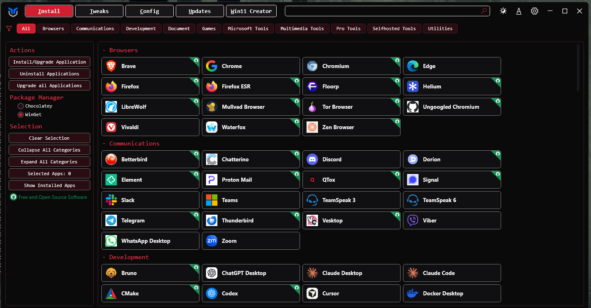
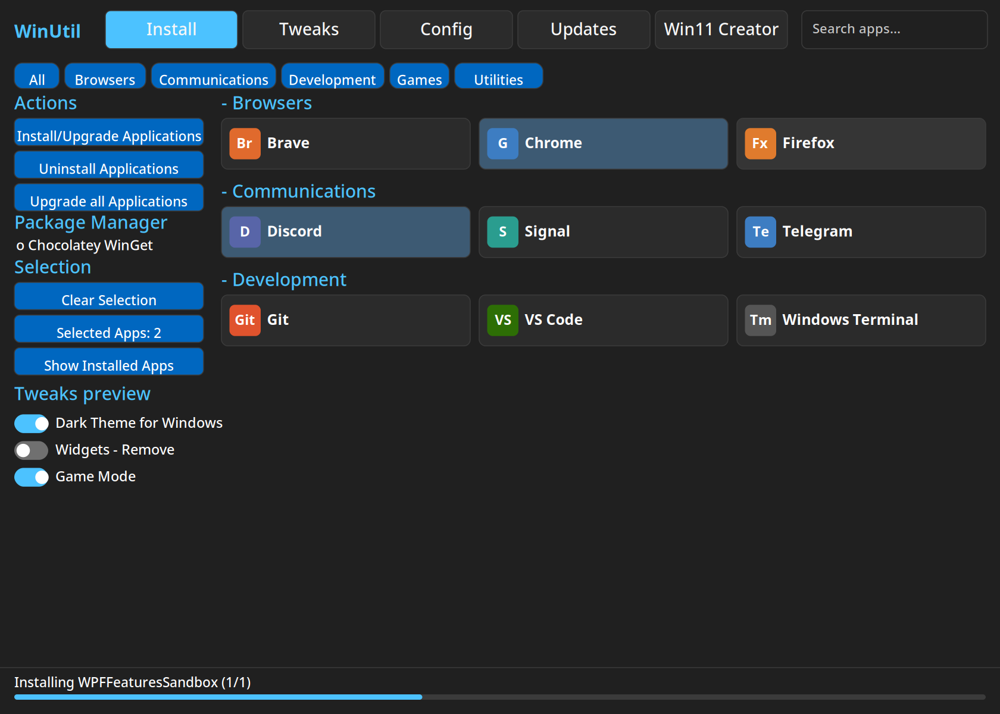
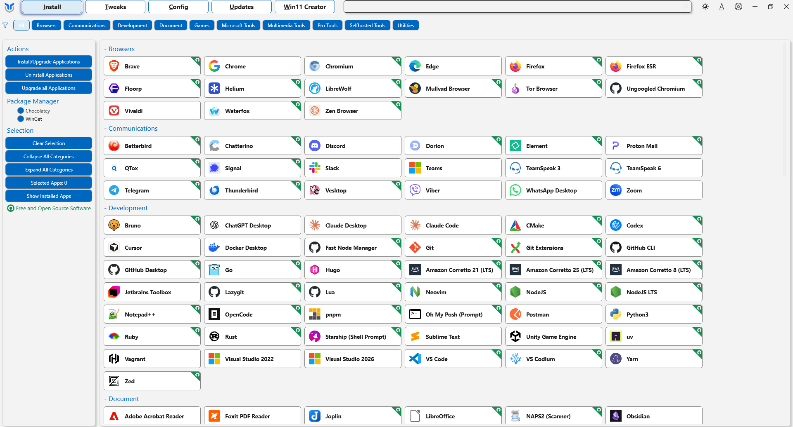
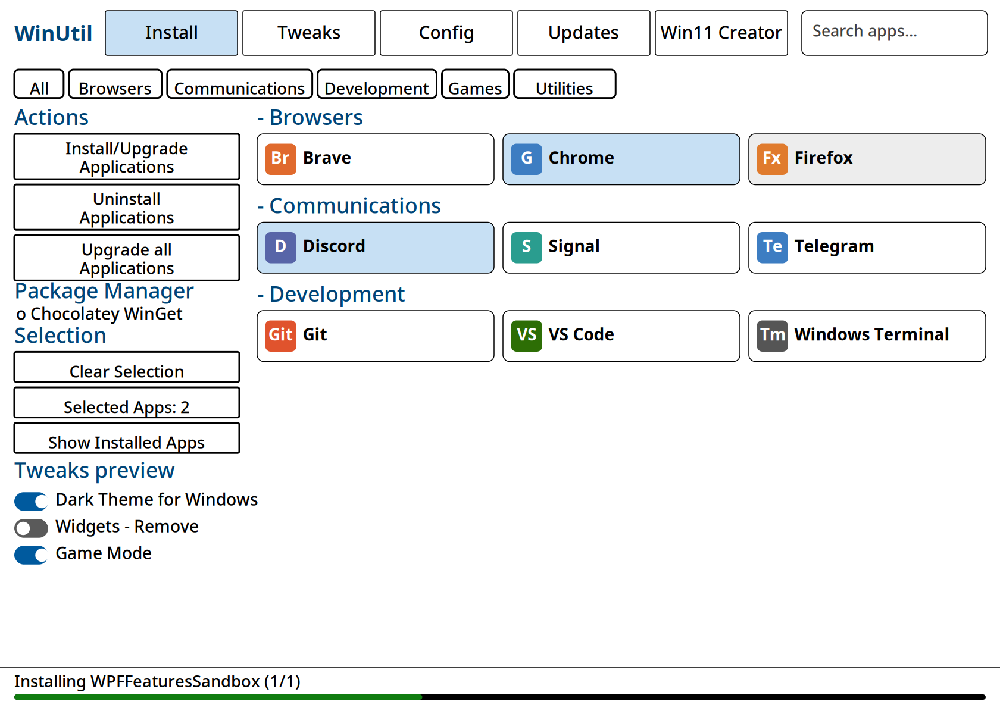
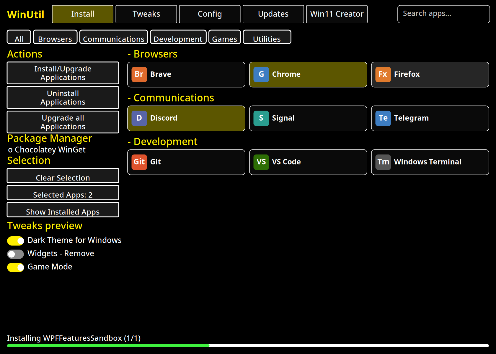
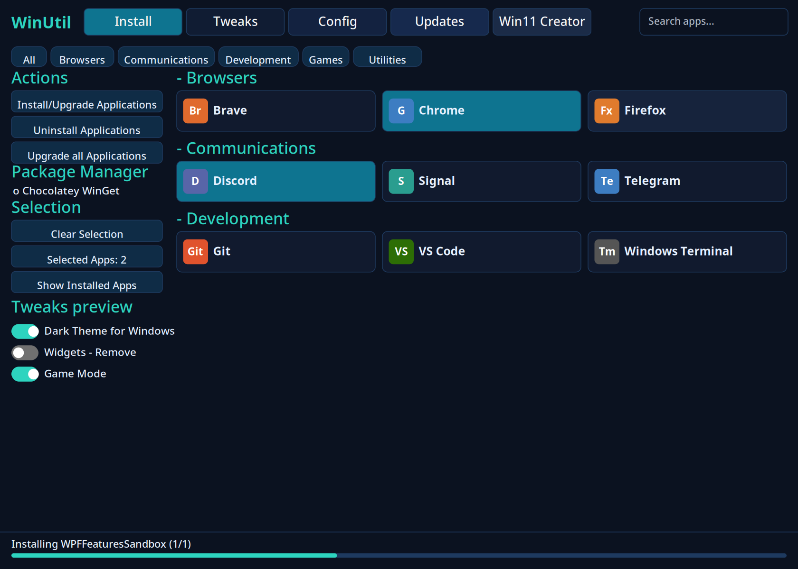
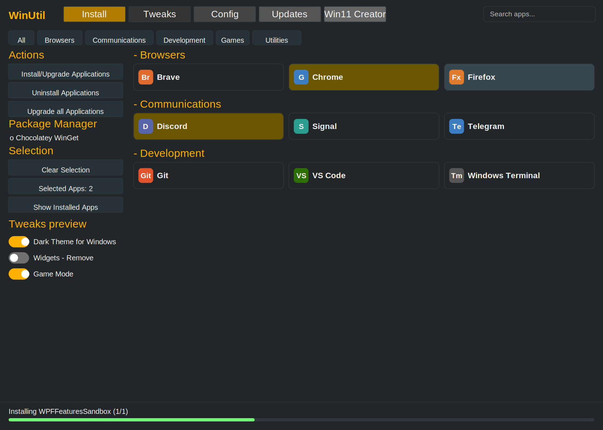
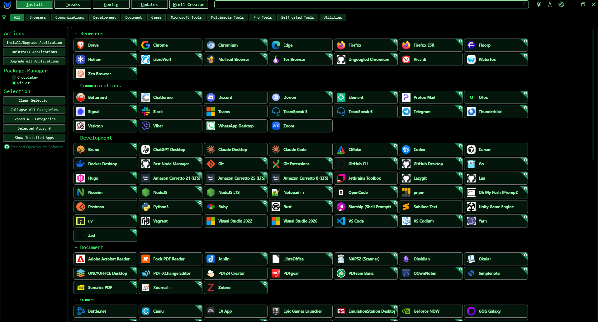
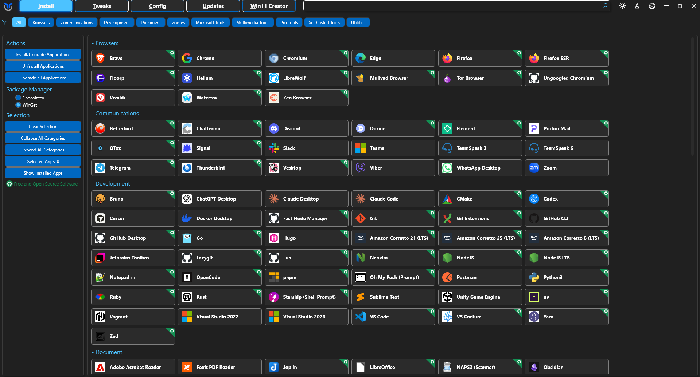

# WinUtil Redesigns

## TL;DR

WinUtil is a well-known Windows tool that installs programs, applies tweaks, fixes settings and controls updates. This repo gives it **new looks**. Each design has **its own one-line PowerShell command**: run the command, and WinUtil opens wearing that design instead of its default one. Underneath, it is exactly the same WinUtil — same programs, same tweaks, same everything. Only the colours, fonts and sizes change, using WinUtil's own built-in theme system, so a design cannot quietly change what the tool does to your PC.

## Launch a design

Open PowerShell or Windows Terminal **as Administrator** (WinUtil needs it — it changes system settings), paste one line, press Enter. Every design below has its picture and its own command with it.

> **About the pictures:** every picture below is a **real screenshot** — the actual WinUtil window on a Windows PC, launched with the command under it (25 Oct 2026). What you see is exactly what the command opens.

### Pro Console



True black, one red accent, monospace type — an expert console. (Mockup #7, the one built out as a full clickable prototype in `docs/`.)

```powershell
irm "https://raw.githubusercontent.com/SeanShaffer88/WinUtil-Redesigns/main/pro-console.ps1" | iex
```

Details: [designs/pro-console/DESIGN.md](designs/pro-console/DESIGN.md)

### Fluent Dark



Windows 11 Settings at night — soft dark surfaces, blue accent, rounded corners, and a tab row sized to read as a navigation bar.

```powershell
irm "https://raw.githubusercontent.com/SeanShaffer88/WinUtil-Redesigns/main/fluent-dark.ps1" | iex
```

Details: [designs/fluent-dark/DESIGN.md](designs/fluent-dark/DESIGN.md)

### Fluent Light



Windows 11 Settings by day — white and light grey, blue accent, rounded corners.

```powershell
irm "https://raw.githubusercontent.com/SeanShaffer88/WinUtil-Redesigns/main/fluent-light.ps1" | iex
```

Details: [designs/fluent-light/DESIGN.md](designs/fluent-light/DESIGN.md)

### Accessible Large



Light, large type, thick borders, big buttons — for tired eyes, high display scaling and touch.

```powershell
irm "https://raw.githubusercontent.com/SeanShaffer88/WinUtil-Redesigns/main/accessible-large.ps1" | iex
```

Details: [designs/accessible-large/DESIGN.md](designs/accessible-large/DESIGN.md)

### High Contrast Night



Black, white and yellow — maximum contrast for low vision and bright rooms.

```powershell
irm "https://raw.githubusercontent.com/SeanShaffer88/WinUtil-Redesigns/main/high-contrast.ps1" | iex
```

Details: [designs/high-contrast/DESIGN.md](designs/high-contrast/DESIGN.md)

### Midnight



Deep navy and teal — a calm dark design for long evening sessions.

```powershell
irm "https://raw.githubusercontent.com/SeanShaffer88/WinUtil-Redesigns/main/midnight.ps1" | iex
```

Details: [designs/midnight/DESIGN.md](designs/midnight/DESIGN.md)

### Compact Expert



The original dark look, tightened — smaller type and tiles, a dominant search bar, more on screen at once.

```powershell
irm "https://raw.githubusercontent.com/SeanShaffer88/WinUtil-Redesigns/main/compact-expert.ps1" | iex
```

Details: [designs/compact-expert/DESIGN.md](designs/compact-expert/DESIGN.md)

### Terminal



Phosphor green on black, monospace everywhere — the classic CRT terminal. Bright green headings, deep-green glass buttons, square corners, and one amber nod on the AppX tab (the other phosphor colour). The eighth design, added by request.

```powershell
irm "https://raw.githubusercontent.com/SeanShaffer88/WinUtil-Redesigns/main/terminal.ps1" | iex
```

Details: [designs/terminal/DESIGN.md](designs/terminal/DESIGN.md)

### Original



WinUtil exactly as its author ships it — same build route as the designs, no design applied. Useful as the comparison point: every preview above differs from this one only in theme values.

```powershell
irm "https://raw.githubusercontent.com/SeanShaffer88/WinUtil-Redesigns/main/original.ps1" | iex
```

Presets work with every design, the same way they do with the original — for example:

```powershell
& ([ScriptBlock]::Create((irm "https://raw.githubusercontent.com/SeanShaffer88/WinUtil-Redesigns/main/pro-console.ps1"))) -Preset Standard
```

## How it works, in plain words

WinUtil is not a normal installed program. When you run the famous one-liner, PowerShell downloads one big script and runs it. That script is built from pieces: the window layout (a file called XAML, which describes where things sit on screen), the lists of programs and tweaks (JSON files — plain text lists a computer can read), the functions that do the work, and a **theme file** that holds the colours, fonts and sizes.

This repo uses that theme file, and only that theme file:

1. `build/Build-Design.ps1` takes the original WinUtil source at one fixed version (commit `2f0bdc8`, pinned so builds never drift).
2. For each design, it writes the design's colours into the theme file — into **both** the Light and Dark slots, because WinUtil chooses between them based on your saved setting and your Windows mode, and the design should win either way. It also merges the design's size and font choices.
3. It then runs WinUtil's own build script, untouched, producing one ready-to-run script per design in `dist/<design>/winutil.ps1`.
4. The short file at the repo root (for example `pro-console.ps1`) is just a launcher: it downloads that design's built script and runs it, passing along anything you typed after it.

**Proof it changes nothing else:** build the Original and any design side by side and compare the two scripts. Outside the theme block and a short build-stamp comment at the top, they are identical, byte for byte (928,073 bytes compared, zero differences, checked 2026-10-25). Every design script in this repo also passes a full PowerShell syntax parse, and the window layout inside it checks out as well-formed.

## Safety — read this first

- **These scripts change system settings, because that is what WinUtil does.** A design changes how WinUtil *looks*, never what it *does* — but what it does is powerful. Read tweaks before you run them, and let WinUtil create a restore point first (it is in the Essential Tweaks list).
- **Run as Administrator**, from a terminal you opened yourself, using the exact commands above. Never run a PowerShell one-liner from a source you do not trust — including this one. The built scripts are plain text: open `dist/<design>/winutil.ps1` and read or search them before running, or build them yourself (below) from the pinned upstream source.
- **Not affiliated with Chris Titus Tech.** This is an unofficial design pack for his MIT-licensed tool. Support for WinUtil itself belongs at the original project's home page:

```
https://github.com/ChrisTitusTech/winutil
```
- The Disable Updates profile inside WinUtil stops security updates while it is active. That warning is in the tool itself and it applies in every design.

## The designs in detail

Each design folder under `designs/` holds a `DESIGN.md` (what it is, its signature colours) and a `design.json` (the exact values the build applies). The visual mockups the designs came from are in `docs/`:

- `docs/winutil-10-mockups.html` — the original set of 10 alternate UI designs (also in Markdown: `docs/winutil-10-mockups.md`)
- `docs/winutil-07-pro-console.html` — the Pro Console design built out as a clickable prototype
- `docs/previews/` — the per-design screenshots used above

### Designs that are still drawings, not launch commands yet

Five of the ten mockups change the **layout**, not just the look — a left-hand navigation sidebar (#1 as drawn), a step-by-step wizard (#2), a dashboard home (#3), a three-pane explorer with explanations (#6), the preset comparison table (#9) and saved setup "recipes" (#10). A theme cannot move controls around, so those need the window-layout file itself reworked while keeping every control name the program's functions expect. They are written up in `docs/layout-designs.md` as the roadmap.

The launch themes are tuned to make that limitation as small as it can honestly be: the Fluent designs size the tab row up into something that reads as a navigation bar and widen the description tooltips (460, or 500 in Accessible Large) so the plain-English explanation for every tweak actually fits — most of the explorer spec's value, inside the current layout; Compact Expert makes the search bar the dominant element, as the search-first design intends; Midnight sizes the Updates and Config buttons toward the dashboard's card actions; Accessible Large pushes every target size the theme exposes. What remains genuinely layout-only is listed, spec by spec, in `docs/layout-designs.md`.

## Build it yourself

Needs PowerShell 7 or Windows PowerShell, on Windows or any OS:

```powershell
git clone https://github.com/SeanShaffer88/WinUtil-Redesigns
cd WinUtil-Redesigns
.\build\Build-Design.ps1 -Design All
```

With no upstream source present, the build downloads the pinned WinUtil commit from GitHub first. To make a new design: copy a folder under `designs/`, edit its `design.json` (colours use `#RRGGBB`; the shared section controls fonts and sizes), rebuild, and its launch command follows the pattern above.

## Verification status

- **Verified here (2026-10-25):** all 9 built scripts (8 designs + Original) pass a full PowerShell syntax parse; embedded theme values match each `design.json`; embedded window layout is well-formed; design-vs-original difference is confined to the theme block (byte-identical elsewhere).
- **Field-verified (2026-10-25):** all nine variants — the eight designs plus Original — were launched on a real Windows PC with their one-line commands and opened in the right colours, fonts and sizes. The screenshots above are those runs.

## Licence and credits

MIT (see `LICENSE`). WinUtil itself is MIT-licensed by Chris Titus Tech and contributors; this repo's designs and build script are MIT by Sean Shaffer. Upstream code is **not** copied into this repo — the build fetches it at the pinned commit, and the built scripts in `dist/` are that upstream code plus a theme, so their licence is the upstream MIT licence, included in `LICENSE` for completeness.
